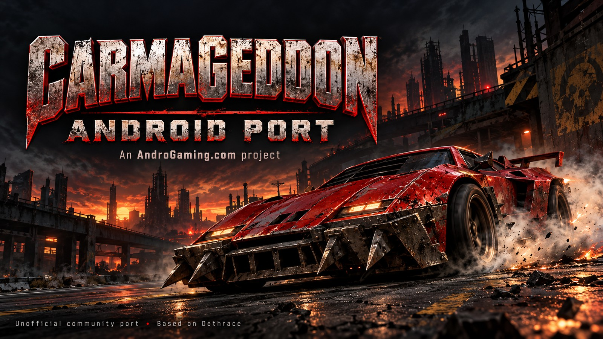

# Carmageddon Android Port

**An [AndroGaming.com](https://androgaming.com) project · Version 0.9.1 test build · Android ARM64**

Play the original Carmageddon on Android using a native engine built on
[Dethrace](https://github.com/dethrace-labs/dethrace), with a launcher, touch and
controller support, configurable graphics and Android-specific rendering fixes.
This is an unofficial community port, unaffiliated with the original game's
owners. **You must supply your own compatible PC game data.** The APK contains
no original `DATA/` or `MUSIC/` files.


https://github.com/user-attachments/assets/c38f63f8-6cae-43a0-aac4-69e019bd09e9


See the
[full AI disclosure](#ai-disclosure) and [credits](#credits-and-licenses).

[Install](#installation) · [Game data](#prepare-your-game-data) ·
[Controls](#controls) · [Tested devices](#tested-devices-and-release-validation) ·
[Changelog](CHANGELOG.md) · [1.0 roadmap](#roadmap-toward-10) · [Build](#building-from-source)

## What to expect

**0.9.1 is a test candidate** for automatic nested-ZIP/GOG installer import, real
streamed music playback and the cockpit rear-view mirror. The public 0.9 release
remains available. See [candidate notes](docs/RELEASE-NOTES-0.9.1.md) for validation
and remaining device checks.

Version **0.9 adds Splat Pack launcher/import support**. The planned 1.0 milestone
is on hold after an unexpected mid-race exit was reported. Its cause is not yet
identified. Earlier testing completed multiple races on Galaxy S24 FE and Retroid
Pocket Flip 2, including upgrades/stage 2 progression, installation/import,
saving/loading and controller remapping. That useful coverage does not rule out
an intermittent crash. The subsequent 0.8 test report describes nearly two hours without crashes;
the supplied 0.8 log records a roughly 54-minute session ending with status 0.
That improves confidence but does not establish a fix for the earlier exit.
Splat Pack integration in 0.9 still requires testing with your own expansion data.

- Dark landscape launcher with game selection and Graphics/Controls/Diagnostics pages.
- Separate Carmageddon and Splat Pack installs/saves using the existing Dethrace expansion support.
- Automatic game-file selection, streamed MUSIC playback and a cockpit rear-view mirror.
- Native 4:3 or 16:9 rendering, three 3D resolution levels and adjustable distance.
- Sharp textures or palette-aware bilinear smoothing; menus and HUD stay sharp.
- 60, 120, 144 FPS or uncapped, with 60 FPS selected by default.
- Customizable touch layout, analog/digital steering and optional haptics.
- Controller driving controls, map, camera, gear overrides and launcher remapping.
- Separate optional error-log ZIP export and performance recording/overlays,
  **off by default**.

The launcher logo/“Android port by” credit opens [AndroGaming.com](https://androgaming.com).
Added project branding appears only in the launcher, with no gameplay watermark.


## Minimum requirements

| Requirement | Minimum / scope |
| --- | --- |
| Android | Android 7.0 / API 24 or newer |
| CPU / Android ABI | 64-bit ARM (`arm64-v8a`); a 64-bit Android installation is required |
| Graphics | OpenGL ES 3.0 support |
| Game files | Compatible Carmageddon or full Splat Pack PC `DATA/`; optional `MUSIC/` |
| Storage | Room for the APK, input/staging copies and extracted game; EXE imports need extra staging space |
| Input | Touchscreen or Android-compatible controller |

These are build/API requirements. Android 7 and low-end devices have not been
validated, and no measured minimum RAM or GPU performance floor is established.
Only an ARM64 APK is supplied; 32-bit ARM, x86 and x86_64 Android are not included.
The ZIP importer accepts up to 2 GiB of extracted data and 50,000 entries.

## Installation

1. Download `carmageddon-android-port-0.9.1-arm64.apk` from this repository's
   **Releases** when available, or use the maintainer-supplied APK.
2. Open the APK on your device. If Android asks, allow APK installation for the
   browser/file manager you are using, then complete installation.
3. Prepare the selected game’s data ZIP below and copy it to your device.
4. Open **Carmageddon Android Port**, choose **Game: Carmageddon** or **Splat Pack**,
   then **Import [game] ZIP or GOG installer** and select the file
   using Android's document picker.
5. Wait until the launcher reports **Ready to race**. Choose settings, then **Play**.

No root access, manual `Android/data` access or ADB is required for normal setup.
An APK alone cannot play the game without imported data.

### Prepare your game data

In 0.9.1, choose **Carmageddon** or **Splat Pack** on Home and select either:

- A ZIP of your installed PC game. Enclosing folders, GOG Max Pack layouts and
  archives containing both games are supported. The launcher selects the chosen
  game's DATA, locates its MUSIC, and merges matching GOG support files itself.
  No manual DATA-root ZIP preparation is needed. Duplicate complete installations
  of the same game are ambiguous and require a ZIP containing one copy.
- A supported, self-contained GOG offline installer EXE. The bundled innoextract
  reader unpacks its data without executing Windows code. The named installer
  `setup_carmageddon_2.0.0.63.exe` still needs real-file/device verification.
  Installers needing companion BIN/RAR files require a ZIP of the installed game
  in this first implementation. See [installer details](docs/IMPORTER-BUILD.md).

Full game data is required; demos and a few marker files are insufficient. No
commercial files are bundled. Original and expansion data/saves stay separate.
Existing installs are never overwritten. Exit the game before importing or
switching. MUSIC is optional; supported audio files are OGG, MP3, FLAC and WAV.
ISO/CUE/BIN disc images and other installer formats are not imported.

### Updates and saves

Install updates **over the existing app**, using the same signing identity.
Do not uninstall or clear storage if you want to retain imported data and saves.
The current application ID is `com.androgaming.carma.next`; AndroGaming versions
0.1.15 onward share this identity. The 0.9.1 APK has a higher internal build code
than 0.9, 0.8 and the earlier 1.0 candidate, so it can update that installation in place. The older `com.androgaming.carma` installation
is separate, with no automatic migration.

The imported game lives under the app's external files directory in `game/`;
on typical devices this is
`Android/data/com.androgaming.carma.next/files/game/`. Splat Pack uses the sibling
`splatpack/` directory, keeping its saves/configuration independent of the original.
Existing `game/` data and saves remain in place. Android may restrict file
manager access. Keep a backup of important saves before changing installations.
Importing is initial setup: the launcher does not overwrite an existing `game/`
directory. Reimport is not a save-migration or backup feature.

## Controls

Touch controls appear during races; menus use taps. The touch layout can be
moved/resized under **Controls → Customize touch layout**. Android text entry is
available for supported name/save-name fields. Recovery on touch uses a hold;
the game's normal recovery costs and restrictions still apply.

### Controller defaults

SDL's standardized button names are used; labels/layouts can differ between
controllers. Inputs can be held together, such as steering + acceleration + repair.

| Action | Default input |
| --- | --- |
| Steering | Left stick; D-pad left/right also retained |
| Accelerate | RT or X |
| Brake / reverse | LT |
| Handbrake | LB |
| Repair | RB, hold |
| Recover / respawn | Y |
| Map | Select / Back |
| Camera: cockpit / external | R3, right-stick click |
| Gear up / down | Right stick up / down |
| Pause | Start |
| Menu navigation | Left stick or D-pad |
| Menu confirm / back | A / B |

Return the right stick to centre between gear changes. These are manual
**forward-gear overrides**: the original automatic gearbox remains active.
Downshifts stop at first gear; reverse remains on the brake/reverse input.
A, B and L3 are otherwise free during races.

**Controls → Remap controller** supports buttons, triggers, stick directions,
Unassigned, a secondary acceleration input and menu confirm/back. Steering can
use left stick, right stick or D-pad. Changes persist and apply on the next Play.
Duplicate bindings activate all assigned actions. **Restore controller defaults**
resets controller settings without changing your touch layout.

## Graphics and performance

| Setting | Choices / behavior |
| --- | --- |
| Aspect | 4:3 classic or native 16:9; wider view rather than stretched scenery |
| 3D resolution | Performance 1×, Standard 2×, High 3× canvas factor on each axis |
| Distance | Original, Extended 1.5×, Far 2× |
| Texture filtering | Sharp, or Smooth palette-aware bilinear |
| FPS cap | 60 default, 120, 144, Uncapped |

Choose settings before Play. Start with Standard / Original / 60 FPS; if your
device struggles, use Performance and Original distance. High resolution,
longer distance and Smooth can increase work. A cap is a ceiling: rendering and
Android's display pacing can still limit FPS. Uncapped does not force a display
refresh rate or guarantee a particular frame rate.

Smooth blends four shaded texture samples, then maps the result back into the
existing game palette using a cached 32×32×32 color lookup. It retains original
cutout coverage and indexed blend tables. The HUD and menus remain sharp.
This is not a true-color conversion, new texture pack, MSAA or FXAA. The table
is rebuilt on palette changes while smoothing is active.

### What was optimized

Profiling guided conservative culling of models outside the view, reduced
redundant model work, canvas-resolution readbacks, batching of eligible shadows,
and deferred composition of shadow/main-scene layers. These reduce avoidable
CPU work and GPU/CPU synchronization while retaining CPU effects and the
indexed renderer. ARM64 NEON also merges readback rows in 16-pixel groups while
preserving transparent palette entries. See [performance notes](PERFORMANCE-NOTES.md).

In synthetic production-renderer tests, six eligible shadow flushes become one,
and a shadow/main-scene pair becomes one readback instead of two, with identical
palette output. These are test workloads, not a promise of those counts in every
race. A Flip 2 0.1.19 gameplay capture at 16:9 / High / Far / Sharp averaged
49.44 FPS after excluding startup/interrupted frames. Readback/synchronization
remained the largest measured cost. That older capture is not a controlled 0.8
benchmark, and no measured FPS gain is claimed for the later NEON change.

## Tested devices and release validation

| Device | Observed software / GPU | Maintainer testing |
| --- | --- | --- |
| Samsung Galaxy S24 FE (SM-S721B) | Android 16; Xclipse 940 via Samsung ANGLE | Multiple completed races; normal play and progression |
| Retroid Pocket Flip 2 | Android 13; Adreno 650, native Qualcomm GLES driver | Multiple completed races; prior shadow flicker confirmed fixed |

The maintainer also confirmed controller defaults/remapping, installation, import,
saving/loading, car upgrades and stage 2 progression during this two-device test
pass. The report did not enumerate every check separately for each device.
Those results cover the driving/rendering base from revised 0.2. The later
unexpected-exit report keeps 1.0 on hold. Version 0.8 added error capture and fixed
inherited crash-report suppression; the supplied 0.8 session contains no Java/native crash report and ends normally.
Version 0.9 expansion selection/import and USB initialization changes still require
device verification. The original intermittent exit remains unexplained.

Automated checks cover viewport/pointer mapping, sprite-copy memory safety,
input bridges and controller polling, gear bounds, frame pacing, culling,
palette/filter shaders, readback composition, shadows and GL state restoration.
GPU checks use Mesa software GLES with synthetic data, alongside real-device
maintainer testing. APK signing, ARM64 native libraries and 16 KiB alignment are
checked separately. [VALIDATION.md](VALIDATION.md) records the evidence and limits.

## Roadmap toward 1.0

These are planned development goals, not features available in 0.9. Version 1.0
will depend on implementation and device testing; no release date is set.

- **Working local LAN/Wi-Fi multiplayer:** allow devices on the same local
  network to host and join races, with connection, synchronization and
  disconnect/reconnect testing.
- **Improved performance:** use profiling to reduce remaining rendering and
  GPU/CPU synchronization costs, improve frame pacing and heavy-scene
  performance, and validate changes on Galaxy S24 FE and Retroid Pocket Flip 2.
- **More 3D filtering and smoothing options:** extend the existing texture
  filtering implementation, assess additional anti-aliasing/smoothing approaches,
  and offer launcher controls with measured image-quality/performance tradeoffs.

Stability testing, Splat Pack validation and regression checks for existing
controls, importing and saves remain part of preparing the 1.0 milestone.

## Known limitations

- Network multiplayer is unavailable and disabled on Android.
- Gear overrides do not provide a selectable fully manual transmission mode.
- Compatibility across all controllers, Android versions and game-data editions
  is not established. TV-only navigation and other architectures are unverified.
- The legacy engine and original game may retain bugs beyond this test pass.
- Heavy scenes can run below the selected cap; some synchronous readbacks remain.
- The distributed APK currently uses the preserved **development signing key**
  and is debuggable; it is not Play Store certified or a new production-signing
  pipeline.
- An intermittent mid-race exit is under investigation. Error capture is best
  effort; Android can omit reports, especially on older devices or SIGKILL exits.

## Diagnostics and bug reports

### Error logs (0.8+)

In **Diagnostics**, enable **Record error logs** before pressing Play. It is
separate from performance recording and defaults to **off**. After an unexpected
exit, reopen the launcher and choose **Export error logs ZIP**. Choose a save
location using Android's document picker, then attach the ZIP to a bug report.
Previous captures can still be exported after switching recording off.

The export contains bounded engine/app warning/error messages, lifecycle events,
settings/version metadata, Java exception stacks if caught, a minimal fatal-native
signal marker when available, and Android's process-exit reason/traces where the
OS provides them. Android 11+ supports exit history; Android 12+ may provide native
tombstone protobufs. No root, broad device-log permission or automatic upload is
added. Logs may contain app messages, local paths or text printed by the app;
review the ZIP before sharing. The latest 12 sessions are retained with per-file
limits. This cannot recover a missing stack from a past uncaptured crash or
guarantee a report for every kind of exit. See [error logging](docs/ERROR-LOGGING.md).

### Performance logs

Recording and the overlay default to **off**. Enable them under **Diagnostics**
when needed; recording captures up to 120 seconds of racing per launch. Export
produces a ZIP containing up to 12 recent sessions, frame metrics, effective
graphics settings, device/driver information and battery/thermal readings.
It contains no game data and is not uploaded automatically. Battery temperature
is not CPU/GPU temperature. Nested timing categories must not be added together.

For a bug, use this repository's **Issues** and include app version, device,
Android version, controller model if relevant, settings and reproduction steps.
Attach screenshots or a diagnostic ZIP where useful; do not upload original
game data, private signing keys or personal files. For performance comparisons,
use the same race, route, settings and similar device conditions.
See [CONTRIBUTING.md](CONTRIBUTING.md).

Common setup fixes:

- **Missing key map / incomplete data:** merge the PC support files and check
  the archive includes the matching GOG support files. Wrapped ZIP folders are detected automatically in 0.9.1.
- **Data already installed:** the importer does not replace an existing game.
  Do not clear storage casually; that also risks saves.
- **Update rejected:** confirm the package/signing key matches. A self-built APK
  normally has a different key from the maintainer's APK.
- **Control performs two actions:** check for duplicate remapping assignments.

## Building from source

Tested Linux build toolchain: JDK 17, Gradle 8.7, Android Gradle Plugin 8.6.1,
SDK Platform 35, Build Tools 35.0.0, NDK 28.2.13676358 and CMake 3.22.1.
The setup script fetches SDL 2.30.10; dependencies require network access.
Install the SDK components using Android Studio or `sdkmanager`, then run:

```sh
git clone https://github.com/armac911/Carmageddon-Android-Port.git
cd Carmageddon-Android-Port
export JAVA_HOME=/path/to/jdk-17
export ANDROID_HOME=/path/to/android-sdk
chmod +x android/gradlew android/scripts/*.sh
./android/scripts/build-dev.sh
```

The clone command requires account access while the repository is private.
Output: `android/app/build/outputs/apk/debug/app-debug.apk`.
On Windows, fetch/extract SDL into `android/app/jni/SDL`, set `sdk.dir` in
`android/local.properties`, and run `gradlew.bat assembleDebug` from `android`.
Build the installer helper described in [IMPORTER-BUILD.md](docs/IMPORTER-BUILD.md) before packaging. Windows builds have not been validated in this release pass.

The source retains `VERSION` so native and Android release metadata agree.
A local debug build uses your machine's signing key and normally cannot update
the maintainer's APK in place. Private signing material is not in this repository.
The optional manually triggered Android workflow builds a CI debug artifact with
its own key; it does not publish or replace maintainer releases automatically.

Selected tests, after SDL setup:

```sh
python3 test/android/test_game_content.py
python3 test/android/test_stream_music.py
python3 test/android/test_mirror_target.py
python3 test/android/test_game_detection.py
python3 test/android/test_usb_registration.py
python3 test/android/test_error_capture.py
python3 test/android/test_error_export.py
python3 test/android/test_controller_mapping.py
python3 test/android/test_touch_bridge.py
python3 test/android/test_gear_override.py
python3 test/android/test_indexed_copy.py
python3 test/android/test_gpu_batch.py
python3 test/android/shadow_compat_test.py
```

Host checks require Python 3, JDK 17 and a C compiler. The synthetic music test also uses ffmpeg. GPU tests also need Linux Mesa
EGL/GLES libraries; they require no original game assets.

## AI disclosure

The README cover is AI-generated promotional artwork created with OpenAI's image-generation tool.

**The changes developed for this AndroGaming fork were made with extensive
OpenAI ChatGPT/Codex assistance, including generated and edited code.** Its role
covered source analysis, implementation, renderer investigation/optimization,
bug fixing, launcher/interface work, automated tests, build tooling, packaging
and documentation. Real world testing by AndroGaming.com members designed features, directed iterations, supplied
branding and screenshots/logs, installed builds, performed physical-device
playtesting and approved results.

The original game, Dethrace engine, inherited Android port and third-party
libraries were not authored by this AI-assisted iteration. Their contributors
retain credit. OpenAI ChatGPT/Codex is credited as an AI development assistant,
not as the owner of the project or an endorsement by OpenAI.

## Credits and licenses

This is an **AndroGaming.com project**, directed and tested by Dejan / AndroGaming.
It builds on substantial prior work:

| Component / contributor | Role | Notices |
| --- | --- | --- |
| [Dethrace and contributors](https://github.com/dethrace-labs/dethrace) | Original engine reimplementation, BRender-compatible code, game behavior and platform harness | [GPL v3](LICENSE), retained source notices |
| [mgrz18/dethrace-android](https://github.com/mgrz18/dethrace-android) | Inherited Android/SDL/GLES integration, initial touch/lifecycle support | [Inherited README](docs/README-inherited-android-fork.md) and retained notices |
| [SDL](https://www.libsdl.org/) and contributors | Android platform, input and other platform services; SDL 2.30.10 | [zlib license](docs/licenses/SDL2-LICENSE.txt) |
| [miniaudio](https://miniaud.io/), David Reid and contributors | Audio support | [Included license alternatives](lib/miniaudio/LICENSE) |
| [libsmacker](https://libsmacker.sourceforge.net/), Greg Kennedy and contributors | Smacker video/audio decoding | [LGPL 2.1 or later](lib/libsmacker/COPYING), source notices |
| [glad](https://github.com/Dav1dde/glad), David Herberth; Khronos Group | Generated GL/GLES loading and API/platform definitions | [glad/Khronos notices](lib/glad/LICENSE), [platform header](lib/glad/include/KHR/khrplatform.h) |
| [Unity](https://github.com/ThrowTheSwitch/Unity), contributors | Inherited C test framework | [MIT license](test/framework/LICENSE.txt) |
| [innoextract](https://github.com/dscharrer/innoextract), Daniel Scharrer and contributors | Native Inno Setup data extraction | [License](docs/licenses/innoextract-LICENSE.txt), [pinned build/source details](docs/IMPORTER-BUILD.md) |
| [Boost](https://www.boost.org/) contributors | Installer reader dependencies | [Boost Software License](docs/licenses/Boost-LICENSE.txt) |
| XZ/liblzma and bzip2 contributors | Installer decompression | [XZ notices](docs/licenses/XZ-COPYING.txt), [bzip2 license](docs/licenses/bzip2-LICENSE.txt) |
| [stb_vorbis](https://github.com/nothings/stb), Sean Barrett and contributors | OGG/Vorbis music decoding | [Pinned source](lib/miniaudio/STB-SOURCE.txt), dual MIT/public-domain notice retained in [source](lib/miniaudio/stb_vorbis.c) |
| OpenAI ChatGPT/Codex | AI development assistance | Full disclosure above |

The codebase carries [GNU GPL version 3](LICENSE); dependency notices retain their
own terms. See [THIRD-PARTY-NOTICES.md](THIRD-PARTY-NOTICES.md). This source snapshot
was restored without complete upstream Git history or a recorded exact base
commit. Its initial repository commit must not be mistaken for original authorship
of the inherited code. The inherited documentation and source notices are retained.

Carmageddon was originally developed by **Stainless Games**. The game, music,
trademarks and original artwork belong to their respective rights holders and
are separate from the engine source license. The maintainer supplied the launcher
branding and game-art icon; inclusion does not grant rights to original game
artwork. No commercial game data is distributed here. This unofficial project
is provided without warranty; see the applicable licenses.

